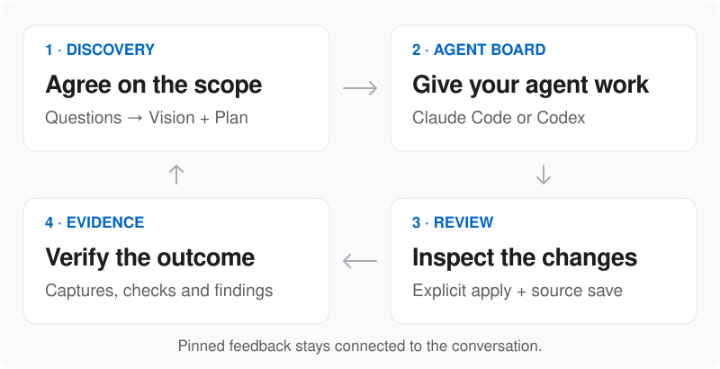

<div align="center">


# Build with agents. Know what works.

**Dogfood connects your app’s scope, coding agents, feedback and evidence in one local workspace.**

[Quickstart](#quickstart) · [Workflow](#the-workflow) · [Agents](#work-with-your-agents) · [Docs](#docs)



</div>

## Quickstart

Requires **Node 22.12+**. No API key or dependency installation is needed for the demo.

```sh
git clone https://github.com/ali-abassi/dogfood.git
cd dogfood
npm run demo
```

Open **[localhost:4321](http://127.0.0.1:4321)**. Tidepool is a fictional swim school showing useful, incomplete and failed QA states. Your projects and review artifacts stay in git-ignored `data/`.

## The workflow

1. **Agree on the scope.** Start with an idea, answer the Discovery questions, define pages and features, then review the current Vision and Plan. New projects need that reviewed baseline before a build starts. Existing projects can connect without pretending discovery is complete.
2. **Give your agent an outcome.** Link a task, page or feature and choose Claude Code or Codex. Save the request for later, or explicitly start it. The agent works in an isolated checkout and returns to Review.
3. **Review the actual change.** Read the patch and safe HTML preview. Explicitly apply and save reviewed source. Pin feedback to a screenshot and continue the same conversation.
4. **Prove the result.** Try the real flow, record captures and check results, and resolve findings after a retest. The project map connects scope → work → evidence; Overview tells you what needs attention next.

**Finishing a request, completing an audit and accepting a feature are separate outcomes.** A completed audit may contain failures. Acceptance requires the current source and environment, the required evidence, passing answers and no unresolved findings. It does not deploy your app or certify an untested integration.

## Work with your agents

The board requires a locally installed `pal` dispatcher and your existing Claude Code or Codex sign-in. Planning and the demo work without it. Browser checks need `agent-browser`; optional AI opinions need their configured paid provider and an explicit usage action.

For terminal access from this checkout:

```sh
npm link
dogfood --help
```

Or give your coding agent the [Dogfood skill](skills/dogfood/SKILL.md). The [CLI guide](docs/cli.md) covers setup diagnostics, tasks, native requests and MCP configuration. **Work myself** claims a task; **Send to agent** delegates it. Notes never start work.

## Evidence for the whole project

| You need to know | Dogfood keeps together |
| --- | --- |
| What are we building? | Discovery answers, Vision, Plan and reviewed scope. |
| What is happening now? | Tasks, agent conversations, blockers and review decisions. |
| How does it connect? | A product map of pages, features, work and evidence; optional saved Graphify context. |
| What should change? | Screenshot pins linked to findings and agent requests. |
| What is actually proven? | Attributed checks, captures, source/build context and explicit gaps. |

Web projects use browser pages and desktop/phone captures. Native app evidence follows its own screen, device and build contract—see [native app setup and limits](docs/native-apps.md). A simulator screenshot is not a physical-device or live-service pass.

## Local by design

- The server binds to loopback. This is a trusted **single-user local workbench**, not a hosted team service or an OS sandbox.
- Start/send, source apply and source save are explicit actions. They do not automatically push, publish, deploy or accept QA. Native-context safeguards prevent accidental self-approval; code running as the same OS user retains local access.
- Screenshots and AI opinions describe what was seen. They do not prove behavior, security, delivery, purchases or production readiness.
- Changed source, captures, environment or review rules can require a recheck. Historical evidence remains readable; paid reviews are not rerun automatically.
- Keep credentials out of cards, source and public artifacts. Preserve existing accounts, browser sessions and project data.

## Docs

[CLI & MCP](docs/cli.md) · [Agent board](docs/agent-board.md) · [Discovery](docs/discovery.md) · [Native apps](docs/native-apps.md) · [Detailed QA reference](docs/reference.md) · [Agent skill](skills/dogfood/SKILL.md)

The interface is plain HTML/CSS/ES modules with a dependency-free Node server. `npm test`, `npm run check` and `npm run lint` cover native logic, syntax/data and function complexity; `npm run test:acceptance` exercises controlled browser flows. Those checks establish their recorded scope, not every project’s live integrations.

[MIT](LICENSE)
